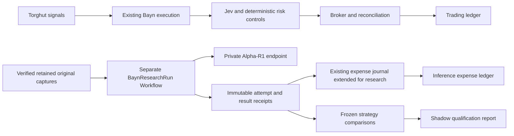

# Connect Alpha-R1 to Bayn research

Status: Proposed implementation plan. The resident endpoint is deployed. The worker and experiments below are not implemented by this document.

Build a separate research consumer that evaluates retained market evidence with Alpha-R1, accounts for its cost and
compares its decisions with existing controls. Keep entry, position management, closure and broker observation
independent of research availability. Deliver P1 through P6 in order, with P2 development permitted alongside P1.
Execute directly without subagents. This plan does not authorize new credential destinations or live capital.

## Establish the starting point

Source inspection used `origin/main` at `091a40a17fd2baabaf215e1d8ffb96708bc6546e`. Refresh the baseline before implementation.

- Alpha-R1 serves the locked `alpha-r1-82c2aa5fcdda` checkpoint. Its [runbook](../../services/bayn-model/README.md)
  defines streaming, one active sequence, two admitted requests, a 180-second total deadline and 4,096 output tokens.
- Rune cleanup is complete. Its namespace, claim, local volume and cached directory were deleted. Alpha-R1's separate
  claim and existing pod remained healthy with zero restarts after cleanup.
- [Original capture](../../services/bayn/src/research-capture/README.md) already records transport, availability,
  independent coverage, hashes and export acknowledgements. The current execution worker has the existing approved
  capture storage references. Its live manifest has no `BAYN_RESEARCH_CAPTURE_SESSION`. Credentials alone prove no
  complete session and are not the old credential-mount blocker.
- [Inference expense projection](../../services/bayn/src/inference-expense-runtime.ts) already quotes Jev consumption,
  freezes evidence and posts deterministic transfers to TigerBeetle ledger `7002` in `USD_PICO`. Extend that accounting
  path. Do not build another journal or quote service.
- [Operating costs](../../services/bayn/src/operating-costs.ts) already distinguish complete, partial and unknown
  evidence. The current token rate schema is specific to TypeSafe. Local GPU cost requires an explicit cost basis.
- [The Jev incremental audit](jev-incremental-audit.md) already specifies immediate momentum, unchanged delayed
  momentum and Jev-filtered arms. Reuse those controls before attributing value to another model.
- The `x` thread's October 11 research adds ticker/date sensitivity diagnostics and action-tape execution calibration.
  Its synthetic checks and reproduced paper aggregates are research leads, not qualified Bayn returns.

## Keep execution independent

Use a Restate Workflow named `BaynResearchRun` with one immutable run ID. Do not key research on the account's
execution Virtual Object or add a handler to the execution endpoint. Restate Workflows have one main execution per
ID and fit finite research runs. The [service-type documentation](https://docs.restate.dev/foundations/services)
describes that lifecycle.

Derive the run ID from the canonical run-contract hash at submission. Verify a returned receipt against that same
contract. Restate deduplication alone does not compare a repeated caller's input. Changed inputs require a new run ID.

Execution adds no model RPC, research send acknowledgement, outbox wait, cost projection wait or research readiness
dependency. Use a separate deployment, Effect runtime, HTTP client and PostgreSQL pools. The research worker has no
broker credential, capital grant or order mutation capability. Retain existing execution authority checks.

Read retained captures independently. Original capture remains bounded observation of the existing consumer, not a
second market consumer or synchronous inference hook. Measure capture overhead before enabling a fixed session.

## Freeze the run and attempt contracts

Define these types with Effect Schema at the boundary. Paths proposed below are new unless marked existing.

| Record            | Required identity and evidence                                                                                                                                                                                        |
| ----------------- | --------------------------------------------------------------------------------------------------------------------------------------------------------------------------------------------------------------------- |
| Research run      | Source revision, study registration hash, capture inventory and content hashes, calendar/session, feature cutoff, candidate factor pool, prompt version, model checkpoint, comparison policy, cost basis and deadline |
| Inference attempt | Run ID, unique attempt ID, exact request hash, model name/revision, client and server request IDs, trace ID, request/first-token/completion times, finish reason, response hash, token usage and terminal outcome     |
| Validated result  | Run and attempt IDs, complete stream termination, allowed unique factor IDs, immutable response object hash and validation outcome                                                                                    |
| Expense quote     | Attempt identity, usage evidence hash, effective cost-basis hash, source evidence, integer currency amount or explicit unknown coverage, deterministic journal identity                                               |
| Comparison result | Registered arm, original availability timeline, retained decisions, feasible arrival times, fills, fees, cost coverage, inventory/close state, exclusions and evaluation-window identity                              |

Use terminal outcomes for complete, rejected, cancelled, expired, ambiguous and unavailable attempts. An incomplete
stream, missing usage or unknown engine outcome cannot silently become successful or free. Retain private payloads
in the existing controlled evidence store. Logs contain identifiers and hashes, never request or response bodies.

Restate journaling does not make an external inference transaction exactly once. See
[durable steps](https://docs.restate.dev/develop/ts/durable-steps) and
[error handling](https://docs.restate.dev/develop/ts/error-handling). Claim an attempt durably before transmission.
If a crash leaves its outcome ambiguous, seal it unknown and require an explicitly distinct attempt. A replay must
not silently issue another paid or resource-consuming request with the same attempt identity. Completed retained
results can replay without inference. Account for every transmitted attempt, including rejected research results.

## P1. Qualify original inputs and freeze the study

**Depends on:** None. This is the economic evaluation prerequisite.

**Files:** Existing `services/bayn/src/research-capture/**`, `src/db/research-capture-postgres.ts`,
`src/intraday-replay/**`, `docs/bayn/jev-incremental-audit.md` and a new study receipt under `docs/bayn/evidence/`.

- [ ] Inventory retained original captures and their independent coverage evidence. Report usable sessions and exact
      exclusions. Do not infer complete capture from bucket existence, mounted credentials or a healthy controller.
- [ ] Reuse a complete qualified session if it exists. Otherwise prepare a fresh, calendar-verified fixed session and
      bounded storage/capture trial through the existing capture path. Never reuse a missed pre-open registration.
- [ ] Preserve all opportunities, abstentions, errors, holding periods and zero-trade periods. A later archive cannot
      repair missing original arrival or decision-feasibility evidence.
- [ ] Freeze candidate sets, features, factor mapping, chronology, fee/slippage stresses, cost basis, train/validation/test
      sessions, label-overlap embargo, experiment count and rejection criteria before viewing evaluation outcomes.
- [ ] Resolve any new credential destination or permission in a concrete reviewed configuration before activation.
      Existing approved capture storage is already wired. A new worker's access is a separate destination.

**Verify:** Existing capture export/replay/session tests reject changed hashes, incomplete independent coverage and
late evidence. A real PUT/GET and retained original-session replay establish input eligibility. Measure recorder
queue, bytes and execution latency against capture-disabled baseline. Missing evidence leaves evaluation UNKNOWN.

**Output:** An immutable eligible-input inventory and study registration, or an exact missing-evidence report. Do not
report an economic comparison until input eligibility passes.

## P2. Build the independent research Workflow

**Depends on:** The input/run contract from P1. Development fixtures can precede qualified live data.

**Files:** New `services/bayn/src/research-inference/**`, `src/restate/restate-research-run.ts`,
`src/restate/restate-research-server.ts`, owning PostgreSQL migrations, image entry points and
`argocd/applications/bayn/research-worker.yaml`. Update the existing Bayn Kargo image path and native Restate registration.

- [ ] Bind `BaynResearchRun` to a dedicated endpoint and deployment using the pinned Restate SDK and Effect cohort.
      Reuse the existing native HTTP/2 identity verification and telemetry adapters without registering execution handlers.
- [ ] Read only the frozen capture manifest and approved evidence. Compute and validate the exact candidate factor
      pool before requesting Alpha-R1. No generated code execution or free-form order interpretation.
- [ ] Stream the pinned model with the server's limits. Start with one client request per worker process. The model's
      existing global admission bound handles overlapping deployments. Do not add a global research Virtual Object.
- [ ] Bound queue/retry time by the run's absolute deadline. Retry explicit pre-admission HTTP 429 responses only
      within the registered budget. Never automatically retry an ambiguous transmission.
- [ ] Forward Effect interruption to HTTP cancellation and close the stream on deadline. Treat truncated output,
      foreign model identity, invalid factor IDs and missing terminal usage as unavailable research.
- [ ] Keep all new database, evidence-store and HTTP clients scoped to the worker. Select only required NetworkPolicy
      routes and approved access. Do not mount broker or capital credentials.

**Verify:** Unit tests cover valid output, malformed SSE, limits, terminal errors and cancellation. Local Restate
integration covers duplicate run IDs, changed input under the same ID, restart before/after request transmission,
retained-result replay and ambiguous attempts. Live acceptance proves an actual complete factor-selection run,
client cancellation to zero model work and independent execution-controller progress during research outage.

**Output:** A deployed, bounded research-only Workflow and retained attempt/result receipts. No candidate strategy admission.

## P3. Extend the existing expense journal for local inference

**Depends on:** P2 attempt receipts. No second accounting system.

**Files:** Existing `services/bayn/src/inference-costs.ts`, `inference-expense.ts`, `inference-expense-journal.ts`,
`inference-expense-postgres.ts`, `inference-expense-runtime.ts`, `operating-costs.ts`,
`forward-performance/inference-expenses.ts` and their tests.

- [ ] Extend the source contract explicitly for Jev provider tokens and research operating-cost allocation. Preserve
      existing immutable Jev quote and transfer identities. Do not reinterpret posted records or fake Jev cycle/grant IDs
      for research. Upgrade affected callers together without parallel legacy loaders.
- [ ] Freeze an effective, source-backed local cost basis. Separate provider charges, incremental energy, allocated
      hardware/infrastructure cost and research overhead. Avoid counting the same energy or infrastructure expense twice.
- [ ] Meter GPU wall time and actual completed-stream usage. Choose and document allocation for idle and shared GPU
      time. Power snapshots and token counts alone do not establish per-request energy or a dollar cost.
- [ ] Quote and post through the existing deterministic journal and `USD_PICO` expense ledger. Run research projection
      with its own scoped clients outside execution transactions. Keep balances and evidence coverage reconcilable.
- [ ] Retain partial/unknown coverage for interrupted, ambiguous or unpriced attempts. A known subset of cost cannot
      become a fully costed P&L. Use a separately identified correction when later evidence settles an unknown expense.

**Verify:** Pure pricing tests cover integer precision, effective windows, absent rates and allocation conservation.
PostgreSQL/TigerBeetle integration covers a crash between freeze/post/acknowledge, exact duplicate verification,
mismatched existing transfers, nonzero expense posting and missing-cost coverage. Ledger outage must preserve pending
quotes and leave execution unaffected.

**Output:** A per-attempt cost receipt, exactly idempotent expense projection and reconciled session cost report.

## P4. Prove observability and performance under load

**Depends on:** P2 and P3. Ship basic spans and metrics with those changes, then qualify their combined behavior here.

**Files:** Existing `services/bayn/src/restate/restate-telemetry.ts`, telemetry owners, new worker instrumentation,
`argocd/applications/observability/bayn-model-dashboard-configmap.yaml`, Alloy configuration and Bayn alert rules.

- [ ] Correlate capture, workflow, attempt, model request, response, quote, transfer and comparison by retained IDs.
      Link worker and native vLLM traces. Expose queue/TTFT/prefill/decode/end-to-end latency, token rate, retries,
      cancellations, expiry, invalid responses, replay behavior and cost-projection lag.
- [ ] Add bounded metric labels and explicit coverage gaps. Preserve NO DATA. Add warning alerts for worker backlog,
      unavailable model and persistent accounting gaps. Keep execution paging separate and test actual routing.
- [ ] Complete the Grafana UI readback using the existing account session. The model dashboard is provisioned and its
      queries execute, but the previous browser check required login. Do not reset credentials as a shortcut.
- [ ] Record a matched execution baseline, then load research with Flamingo simultaneously. Measure entry and closure
      stage latency, broker submit/ack/observe delays, database acquisition/commit, event-loop lag, GPU/KV pressure,
      model cancellation and memory. Preserve broker latency separately from local processing.
- [ ] Propose an initial research-admission guard of no more than 5% p95 and 10% p99 local execution-latency increase
      over the matched baseline, with zero additional missed protective-close deadlines. These are proposed limits,
      not measured results. Freeze the sample requirement and method before the trial. Insufficient samples stay UNKNOWN.
- [ ] Pause research through its own reviewed configuration if the guard fails. Do not relax execution deadlines,
      risk checks or Flamingo's context. Apply a critical-path fix only to a reproduced, traced cause, then rerun the pair.

**Verify:** Fetch a real worker-to-model trace and matching structured logs from Tempo/Loki. Query Mimir and render
the dashboard. Exercise 429, expiry, cancellation and expense-store failure while execution continues. Active-session
entry and closure measurements are mandatory; Sunday readiness samples do not qualify trading latency.

**Output:** A reproducible baseline/load report and a pass, fail or insufficient-data performance verdict.

## P5. Run registered comparisons and diagnostics

**Depends on:** Qualified P1 inputs and P3/P4 cost and timing evidence.

**Files:** Existing `services/bayn/src/intraday-replay/control-study.ts`, `matched-entry-study.ts`,
`matched-entry-lifecycle.ts`, `jev-incremental-audit.test.ts`, `services/bayn/tools/matched-entry-study.ts`,
`services/bayn/src/control-study-command.ts`, the backtest entry point and a new narrow factor-selector adapter under
`research-inference/`. Reuse the native lifecycle, risk, fee and accounting implementation.

- [ ] Run the existing immediate/delayed/Jev three-arm audit first. Report selection effect, delay effect and total
      increment. Follow matched-opportunity diagnostics with independently evolving complete portfolios.
- [ ] Compare Jev-only, Alpha-R1-assisted research selection, Flamingo and one frozen cheap numeric selector on the
      same eligible inputs, candidate pool, budgets, risk bounds and cost assumptions. Preserve the no-trade outcome.
- [ ] Declare how factor selection maps to Bayn's actual horizon before testing. Alpha-R1's published setting cannot
      establish usefulness for Bayn. A changed holding horizon is a separate registered experiment.
- [ ] Test original, ticker-aliased, relative-date and combined request representations with repeated-original
      controls. Keep numerical inputs fixed. Retain all responses and costs. Decision sensitivity is not proof of leakage
      or alpha, and later model calls cannot replace contemporaneous retained decisions.
- [ ] Replay a frozen action tape against original market/ack/cancel events before interpreting simulated returns.
      Reject earlier-than-arrival fills, reused liquidity, missed cancel/fill races and unexplained inventory divergence.
      Do not shuffle signals in a way that changes turnover, holding time or opportunity feasibility.
- [ ] Report net P&L, incremental value, drawdown, turnover, exposures, tail losses, latency, all-cost coverage and
      session-blocked uncertainty. Keep trial history and evaluate untouched sessions once. Paper fills do not prove
      live queue position, market impact or capacity.

**Verify:** Existing replay/accounting tests plus explicit look-ahead, missing-input, partial-fill, race, incomplete-close
and cost-stress cases. A reproducible command must regenerate retained reports from their hashes and source revision.
Reject the candidate when registered economic criteria fail. A rejected result is a complete experiment.

**Output:** An auditable comparison report with a selected candidate or an explicit no-advantage conclusion.

## P6. Qualify a candidate in shadow, then paper

**Depends on:** P5 economic evidence and P4 performance acceptance.

- [ ] Run the candidate prospectively in shadow from a fresh registration. Compare predictions and realized outcomes
      after every session, including outages and cost gaps. It cannot mutate the execution strategy.
- [ ] Define paper evaluation duration/sample, risk bounds, economic minimum and stop conditions before observing
      outcomes. Require adequate coverage and untouched out-of-sample evidence rather than a fixed short winning streak.
- [ ] Use Bayn's existing qualification lock, result and strategy-admission contracts for any later paper activation.
      A research result, healthy pod or expense reconciliation never supplies capital authority.
- [ ] Produce a qualification report with net economic value, uncertainty, performance, accounting coverage and
      authority status. Fail or remain unqualified when any required evidence is missing.

**Verify:** Prospective retained predictions, exact session accounting, complete close evidence and stress acceptance.
Verify the deployed source/image and actual product behavior for every authorized rollout. Live-capital activation
remains a separate decision through the existing authority path.

**Output:** A qualified paper candidate or an explicit rejection. Profitability is an evidence requirement, not a promised outcome.

## Deliver and stop at each boundary

Use the repository's local checks, automatic review and required CI. For Bayn code changes, run the component's
documented test, typecheck, formatter/lint and build checks, plus relevant real PostgreSQL, TigerBeetle and Restate
integration tests. Render changed GitOps resources and validate their contracts. Documentation-only work needs links,
format and diff validation rather than a runtime test suite.

For each explicitly authorized deployment, retain merged source, successful immutable image publication, eligible
Freight, automatic Stage promotion, generated Kargo commit, exact Argo revision and the phase's live behavior.
Do not bypass Kargo, add Rune compatibility, weaken risk controls or call an infrastructure-only check product proof.

This planning task ends with the retired storage removed and this plan available for review. It does not start P1,
create automations or grant new production access. Implementation begins under a subsequent execution instruction.

## Source notes

- [Resident model runbook](../../services/bayn-model/README.md) owns serving limits and delivery.
- [Original capture contract](../../services/bayn/src/research-capture/README.md) owns retained input eligibility.
- [Jev incremental audit](jev-incremental-audit.md) owns the existing delay/selection controls.
- [Alpha-R1 model card](https://huggingface.co/FinStep/Alpha-R1) and
  [upstream implementation](https://github.com/FinStep-AI/Alpha-R1) describe the trained factor-selection interface.
- [Execution-assumptions study](https://arxiv.org/html/2610.05077v1) and
  [KTD-Fin](https://arxiv.org/html/2605.28359v1) motivate the X thread's diagnostics. They do not qualify Bayn.
- [Alpaca paper-trading assumptions](https://docs.alpaca.markets/us/docs/paper-trading) constrain interpretation of paper fills.
