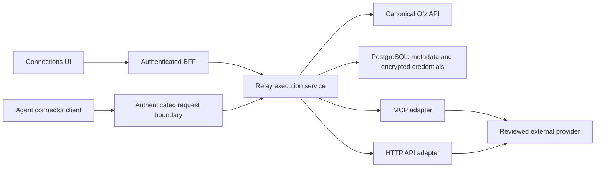

# Relay connector gateway

Status: implementation contract for the connector gateway. PR #14822 is retired in favor of #15205.
Stage 1 shipped dormant native support in #15300. Stage 2 extracts the private service and prepares its infrastructure;
its [rollout runbook](../../argocd/applications/relay/README.md) records the activation prerequisites. This document does
not establish a completed production rollout.

## Product contract

Users connect an external account once, select the operations and resources available to each workspace, and can
disconnect it without entering the guest. Provider credentials never enter an agent home, Codex configuration,
browser storage, API response, telemetry, or an Ofz policy tuple. A connection is reusable across workspaces;
revoking one workspace's access does not disconnect the account from other workspaces.

Protocol and authentication are independent. Protocol adapters implement remote MCP and named HTTP API operations;
an HTTP adapter also supports GraphQL through a reviewed POST operation. Authentication supports unauthenticated
public endpoints, static bearer tokens, API-key headers, and OAuth2 authorization-code/PKCE or client-credentials
flows. OAuth is not a protocol adapter. Provider definitions are operator-reviewed configuration, not arbitrary URLs
or executable code supplied by an agent.

## Records and authority

- A provider definition specifies immutable ID/version, protocol, fixed HTTPS destination, operations and JSON
  argument schemas, authentication options, OAuth endpoints, client identity, and provider scopes.
- A connection has an immutable UUID, owner, provider/version, display name, status, granted scopes and encrypted
  credentials. Public projections contain no token or credential ciphertext.
- A workspace binding selects connection, exact workspace UID, allowed operations and resource constraints.
  A binding never substitutes for the canonical Ofz workspace and connector authorization checks.
- Ofz owns platform membership, connection authority, delegation, current workspace/runtime authority and revocation.
  Relay does not receive the SpiceDB administrative key or recreate the old Relay ownership graph.
- Human operations enter through the authenticated BFF. Agent operations require an authenticated, runtime-bound
  request boundary; possession of a connection UUID, workspace name or claimed actor ID grants no access.

## Credential storage

Use dedicated PostgreSQL tables and a least-privilege runtime role. Encrypt credential JSON using AES-256-GCM,
with a fresh random 96-bit nonce on every write. Associated data binds connection UUID, owner, provider and key
version, preventing ciphertext substitution across accounts. The database holds ciphertext, nonce and key ID;
the encryption key is mounted separately from the database and excluded from its backups. Missing keys, unknown
versions, authentication failures and incomplete credential records fail closed.

Key rotation installs a new active encryption key while retaining decrypt-only old keys until all records and
retained backups have migrated or expired. Never silently regenerate a missing key. Database TLS verifies the
server name. Provider application credentials are backend-only configuration; user access and refresh tokens live
in the encrypted store rather than one Kubernetes Secret containing every user's tokens.

## OAuth lifecycle

Authorization-code attempts use S256 PKCE, random state, exact registered callback URIs, a short database-clock
expiry and one-use consumption. Bind attempts to the authenticated owner, session, provider and connection;
OAuth callbacks must not become a cross-site request-forgery bypass. Exchange codes on the server and never send
tokens to the browser. Reject expanded or unexpected provider scopes. An omitted initial scope means the requested scope; an omitted refresh scope retains the existing grant.

Persist access token, optional refresh token, provider scopes and expiry atomically. Coordinate refresh with a
durable per-connection compare-and-swap claim across replicas. Re-read after claiming refresh, use a bounded request deadline,
preserve an old refresh token only when the provider omits a replacement, and atomically install a rotated token.
An uncertain refresh never blindly retries a consumed rotating token. Invalid grants mark the connection as
requiring reconnection. Client-credentials flows obtain a new access token rather than assuming a refresh token.

Disconnect denies new dispatch before attempting provider revocation. Pending authorization attempts are cancelled;
encrypted credentials are erased from the connection. The revocation outbox retains only the encrypted token and
its captured revocation endpoint/client authentication until provider revocation completes. Guest removal is queued durably before workspace bindings are deleted, then
reconciled when a guest is ready, including on resume and workspace listing. Failed provider revocation remains recorded and retryable without restoring local
access. Already dispatched provider requests cannot be undone by local disconnect.

## Execution and performance

Validate a named operation and schema before resolving credentials. Check current Ofz authority and workspace
binding immediately before dispatch, including after OAuth refresh or MCP initialization. Reject unsupported
operations and unapproved destinations. HTTP methods alone do not determine whether an operation mutates data.
Mutations need explicit `ConnectorInvoke` grants. Use provider idempotency when the reviewed operation supports it; never automatically replay a mutation after
an uncertain response.

Use shared bounded clients, compiled schemas per provider version, per-workspace and global concurrency limits,
response byte limits and end-to-end deadlines. Pin validated public destination addresses and reject redirects,
private/mixed DNS answers and ambient proxy use. Connection reuse must retain destination validation, account
isolation and credential-rotation semantics. Parse MCP SSE incrementally without rescanning old frames.

Record connection ID, workspace UID, operation, outcome, receipt and latency; exclude credentials, arguments and
response bodies. Benchmark warmed HTTP and MCP calls, refresh contention across replicas, slow upstreams and
large fragmented responses. For production qualification, report p50/p95/p99 gateway overhead separately from provider latency.
No production throughput claim is established by the correctness fixture.

## Acceptance and delivery

The implementation must exercise the actual UI/BFF, service, PostgreSQL, OAuth provider fixture, MCP/HTTP provider
fixtures and agent request boundary. Cover owner isolation, wrong workspace/runtime, grants and membership
revocation, disconnect racing a request, token refresh/rotation, callback replay, SSRF, credential leakage,
restarts and concurrent replicas. Unit mocks alone do not establish end-to-end completion.

Ship through reviewed main, immutable image publication, Kargo promotion and Argo reconciliation. Provider setup,
database roles, encryption keys and registered callbacks are explicit deployment inputs. A successful test fixture
or source merge is not evidence of a production rollout or a real provider account connection.

## Staged delivery boundary

Stage 1 provides default-off Ofz, controller and guest support. Stage 2 adds the private Rust gateway, encrypted
PostgreSQL store, OAuth/protocol adapters, durable cleanup/install records and catalog-independent provider revocation.
The prepared application uses an empty catalog and disabled dispatch. Its Kargo policy and ApplicationSet enrollment
remain held until the reviewed database overlay and 1Password material are ready.

Connections Settings, BFF routes and guest installation orchestration remain in #15205 for a later canary stage.
Before activation, also qualify the additive native schema migration, eligibility enforcement, provider registration
and full browser-to-provider flow. The TLS PostgreSQL/provider fixture exercises actual encrypted records and revocation
after catalog version changes, catalog removal, key rotation and secret-file removal. It does not prove a production
provider login or completed deployment.
