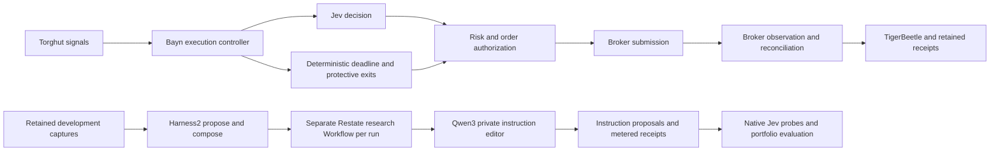

# Bayn Jev instruction editor

`bayn-model` serves the pinned general instruction model [Qwen/Qwen3-8B](https://huggingface.co/Qwen/Qwen3-8B)
on Turin's Blackwell GPU for Harness2 proposals and reflection about Jev's question instructions. It replaces
the Alpha-R1 factor-selection checkpoint and has no active factor-selection contract or model fallback.
It serves private, bounded research inference at
`http://bayn-model.bayn-model.svc.cluster.local:8080/v1/chat/completions`.

Jev remains Bayn's trading decision model. Entry, position management, protective exits, broker observation and
TigerBeetle accounting do not call this endpoint. A model outage therefore pauses research without adding a wait,
retry or fallback to execution. General instruction-following capability is the reason for this editor choice;
it does not establish financial prediction or improved Bayn decisions. No live strategy admission is granted by
this deployment.

## Model and serving identity

- Checkpoint: `Qwen/Qwen3-8B`, revision `b968826d9c46dd6066d109eabc6255188de91218`.
- Served name: `qwen3-jev-editor-b968826d9c46`.
- Architecture: Qwen3-8B, BF16 safetensors, no remote model code.
- vLLM: `v0.29.0-cu129`, immutable index
  `sha256:7ef5a35d1ef8ce2cf9d671dd91eec6e367c5849262e0362b4d3d4a26be0d87d2`.
- GPU: one time-sliced slot on Turin's single RTX PRO 6000 Blackwell Max-Q. Slots do not isolate GPU memory or compute.
- Launch budget: 24% of physical VRAM, 32,768 total context tokens, 2,048 batched prefill tokens, one active sequence.
- Generation: native frozen policy uses non-thinking mode, temperature 0.7, top-p 0.8 and top-k 20, following the
  [authors' non-thinking guidance](https://huggingface.co/Qwen/Qwen3-8B#best-practices). The server-wide output
  ceiling remains 4,096 tokens, with the Qwen3 reasoning parser and prefix cache enabled.
- Every completed stream includes actual token usage, forced server-side even when the caller omits stream options.
- HTTP admission: two in-flight requests, at most one waiting behind the active sequence, 262,144 request-body bytes,
  180-second total request deadline including body input, queue and generation. Excess work receives HTTP 429 immediately.
  Requests must set `stream: true`; multi-choice generation, logprob requests and output budgets above the ceiling
  are rejected before engine admission. Streaming gives the worker token timing and uses the framework's cancellable
  response generator. The pinned vLLM non-streaming handler leaves detached tasks on parent cancellation, so that
  path is closed rather than wrapped in another serving layer.

The editor retains all candidate signal groups, exclusions and complete-plan alternatives, including stop, target,
estimated loss and estimated profit. Repeated immutable facts share references within the prompt; archived
trajectories retain their original evidence. The pinned tokenizer measured up to 22,304 input tokens for the
19-candidate, 16-plan synthetic composition/reflection fixture. Its 4,096-token output allowance exceeds a 16,384-token
context and fits the 32,768-token budget. Actual serving and shared-GPU capacity still require runtime proof.

Prompt-edit requests constrain generation with a JSON schema for the native one-field instruction document.
Reflection requests keep their separate text format. The pinned [vLLM structured-output API](https://docs.vllm.ai/en/v0.29.0/features/structured_outputs/) supports both request types; this does
not qualify an editor's financial reasoning or a generated strategy.

The current `bayn.jev-harness2-editor.v3` contract accepts bounded instruction proposals and evidence-supported
reflection. A proposal changes only the complete-plan `entry` instruction. Validate their schema and
native request identity before a probe. Generated text is data; the editor cannot add executable code, change
market state or choices, alter risk policy, or submit an order. A truncated, timed-out, malformed or foreign-model
response cannot be a completed proposal. Retained Alpha-R1 registrations remain readable immutable evidence;
the worker and submission command reject them for new inference.

`model-source.json` is the generator input. `python3 lock_model.py` resolves exact byte lengths and SHA-256 hashes
into `model-lock.json`; review checkpoint changes together. The init container downloads public files without an HF
token, verifies every cached or downloaded file, and atomically publishes each download. A corrupt existing file
fails closed and remains available for inspection. The vLLM container loads only that local verified checkpoint and
runs with offline Hugging Face access. A 32 GiB local-NVMe claim stores the approximately 15.3 GiB weights and runtime
cache. Provisioning is sequential and uses no GPU. The PVC belongs to this single model deployment. Its `Recreate`
strategy terminates the previous server before provisioning starts. The init process removes other real checkpoint
directories named by a full revision hash before downloading the replacement, preserves the separate runtime cache,
and refuses checkpoint symlinks. It requires space for all missing locked files plus 2 GiB of runtime headroom.
A rollback re-downloads the former pinned checkpoint; it does not depend on a retained obsolete copy.

The provisioner image contains the lock, launch profile and small admission middleware. Kargo promotes that image;
the reviewed Deployment pins the upstream vLLM runtime. This avoids rebuilding CUDA or duplicating its roughly
9.8 GiB compressed base in the internal registry. Init completion copies the versioned launch code into an emptyDir
mounted read-only by the serving container. Both containers run as non-root with a read-only root filesystem and no
service-account token. NetworkPolicy admits only `bayn-research` pods in Bayn, the central observability collector and this application's pods. There is no public
Ingress, Rune API alias, old model fallback or local execution poller.

## Execution and research boundary

The execution graph has no dependency on the resident research endpoint:



The research worker uses a separate deployment, process, connection pools and immutable run identity. It reads
retained captures independently; execution adds no editor RPC, send acknowledgement or outbox wait. The editor
has no access to final-test results during proposal or composition. Native probe completion is distinct from full
portfolio evaluation and acceptance. Research results require untouched comparisons with the unchanged strategy,
repeatability and financial controls before adoption.
Shared-GPU contention still needs a measured baseline and overload test; asynchronous orchestration alone does not
provide resource isolation.

The [Jev Harness2 contract](../../docs/bayn/harness2.md) defines the current integration, and its linked design
audit records remaining evaluation requirements. The former factor-screening plan is historical design evidence.

## Observability and cost

The existing central Alloy scrapes `/metrics` and `/admission/metrics` every fifteen seconds, forwards bounded metric
families to Mimir and retains provisioning/serving logs in Loki. Use Grafana Explore with `job="bayn-model"`
for vLLM latency, token throughput and capacity, and `job="bayn-model-admission"` for admission outcomes.
The standalone model dashboard is removed; this independent research service is outside Bayn's execution path.
Missing series and no-traffic quantiles remain unobserved.

Admission logs contain a generated request ID, immutable model identity, request-body hash, a validated W3C trace ID
when supplied, HTTP status, outcome and duration.
The generated request ID is passed through vLLM's response header. Native request traces use the existing Tempo
OTLP HTTP endpoint and the `bayn-model` service identity; expensive detailed model/worker tracing is disabled. Prometheus labels never contain request IDs,
trace IDs, factor lists or prompts. Request/response-body logging and access logs are disabled. Unknown generation
and model-management routes are closed; health, model identity and metrics stay available during admission overload.
Cancellation reaches the underlying ASGI handler before its slot is released. A timed-out stream ends incomplete
and must be rejected by its consumer. Research-model downtime and repeated expiry are warning alerts without email
paging; execution alerts retain their independent readiness and risk conditions.

OpenAI-compatible `usage` reports actual prompt and completion tokens. There is no provider API charge, but local
inference is not free. GPU time, electricity and allocated infrastructure/research costs need priced operating-cost
receipts before posting an inference expense to TigerBeetle. This endpoint neither invents a per-token price nor
posts a zero expense. Usage, allocated cost and realized net strategy value are different evidence. The research
worker must retain checkpoint, prompt, input, run and request identities with usage and expense receipts.

Each inference response carries `x-bayn-serving-identity`: the model alias, checkpoint, tokenizer and chat-template
revision from the verified model lock, plus the deployment-bound vLLM image digest. CI verifies that the digest
matches the serving container image and the native vLLM contract test image. The research client rejects missing
or mismatched identity before consuming output and retains the attestation in its immutable receipt. Independent
model and research promotions cannot silently accept output under a different frozen serving policy.

## Validation

From the repository root:

```sh
ruff check services/bayn-model
ruff format --check services/bayn-model
python3 -m unittest discover -s services/bayn-model -p 'test_[ar]*.py' -v
bun test packages/scripts/src/shared/__tests__/kargo.test.ts packages/scripts/src/shared/__tests__/enabled-apps.test.ts
kustomize build argocd/applications/bayn-model
bash scripts/kubeconform.sh argocd/applications/bayn-model argocd/applications/kargo argocd/applicationsets/platform.yaml
```

CI tests the provisioner on both published architectures and runs `test_vllm_contract.py` inside the exact pinned
vLLM image with its supported `VLLM_TARGET_DEVICE=cpu` platform selection and without GPU allocation. That test parses the actual launch arguments and verifies the middleware import,
model identity, concurrency, output limit and logging controls. It does not establish GPU startup or inference.

## Delivery, acceptance and recovery

Use the normal main-only signed image pipeline, `bayn-model` Warehouse and Stage, generated `kargo/bayn-model` commit,
and Argo Application. The Stage reads the tested image's source revision and build receipt; changing unrelated Kargo
paths does not rebuild CUDA or manufacture an image alias. The upstream server digest and provisioner remain one
reviewed source contract. Do not release a local image or manually bump the selected digest.

Rune's application, workloads, delivery resources, namespace and model cache have been retired. The explicitly
requested storage cleanup also removed its local volume and cached directory. `bayn-model` owns its separate
namespace and `bayn-model-cache` claim. That current claim retains `Prune=false,Delete=false`.
Research availability may have a gap during image publication and model download. The endpoint is independent of
the active Jev trading path. vLLM checks free physical VRAM before loading. Insufficient free memory must fail
startup rather than lower its checks or increase the shared GPU budget.

For an authorized rollout, record and verify:

1. Exact merged source, successful CI and immutable provisioner digest/signature.
2. Eligible Freight, automatic Stage promotion and the generated `kargo/bayn-model` source commit.
3. No retired resident model workload or delivery resource; the current model owns its independent cache.
4. Argo's exact desired/deployed revision and digest, both init and server completion/readiness, and `nvidia-smi`
   process/VRAM readback on Turin. Preserve Flamingo's 262K context and current resource limits.
5. `GET /v1/models` returns the exact served name. A bounded factor-selection request returns HTTP 200, nonempty
   allowed factor identifiers, complete termination and actual token usage. Test excessive output limits, overload,
   client cancellation and server expiry; confirm cancelled work leaves no engine request running.
6. Mimir scrapes, dashboard queries, Loki request correlation and loaded warning rules work after reconciliation.
   Compare Bayn execution latency and broker/closure telemetry before and during model load. Serving readiness and
   synthetic inference do not establish strategy profitability.

If startup or contention fails, stop research through a reviewed GitOps change (`replicas: 0`) while preserving its
claim. Inspect checksum failures, exact logs, VRAM, KV pressure, disk and host memory before changing budgets. Do not
reduce Flamingo context, bypass Kargo or change trading authority as a recovery shortcut.
