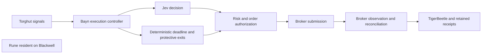
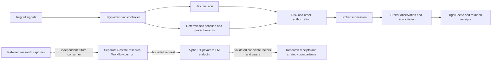

# Bayn financial model

`bayn-model` replaces Rune with the public [FinStep/Alpha-R1](https://huggingface.co/FinStep/Alpha-R1)
checkpoint on Turin's Blackwell GPU. It serves private, bounded research inference at
`http://bayn-model.bayn-model.svc.cluster.local:8080/v1/chat/completions`.

Jev remains Bayn's trading decision model. Entry, position management, protective exits, broker observation and
TigerBeetle accounting do not call this endpoint. A model outage therefore pauses research without adding a wait,
retry or fallback to execution. Alpha-R1's published five-day factor-selection experiment does not establish an
advantage for Bayn's fifteen-minute holding horizon. No live strategy admission is granted by this deployment.

## Model and serving identity

- Checkpoint: `FinStep/Alpha-R1`, revision `82c2aa5fcdda6b4ff00caeba68b0903f13d0e1a5`.
- Served name: `alpha-r1-82c2aa5fcdda`.
- Architecture: Qwen3-8B, BF16 safetensors, no remote model code.
- vLLM: `v0.29.0-cu129`, immutable index
  `sha256:7ef5a35d1ef8ce2cf9d671dd91eec6e367c5849262e0362b4d3d4a26be0d87d2`.
- GPU: one time-sliced slot on Turin's single RTX PRO 6000 Blackwell Max-Q. Slots do not isolate GPU memory or compute.
- Launch budget: 24% of physical VRAM, 16,384 total context tokens, 2,048 batched prefill tokens, one active sequence.
- Generation: greedy by default; server-wide output ceiling 4,096 tokens, Qwen3 reasoning parser, prefix cache enabled.
- HTTP admission: two in-flight requests, at most one waiting behind the active sequence, 262,144 request-body bytes,
  180-second total request deadline including body input, queue and generation. Excess work receives HTTP 429 immediately.
  Multi-choice generation, logprob requests and output budgets above the ceiling are rejected before engine admission.

Alpha-R1 is trained to select allowed factor identifiers in `<alpha_list>...</alpha_list>`. Preserve that trained
format and validate every returned identifier against the experiment's candidate pool. Do not execute generated
code or admit model text directly as an order. A truncated, timed-out, malformed or foreign-model response cannot
be a research result.

`model-source.json` is the generator input. `python3 lock_model.py` resolves exact byte lengths and SHA-256 hashes
into `model-lock.json`; review checkpoint changes together. The init container downloads public files without an HF
token, verifies every cached or downloaded file, and atomically publishes each download. A corrupt existing file
fails closed and remains available for inspection. The vLLM container loads only that local verified checkpoint and
runs with offline Hugging Face access. A 32 GiB local-NVMe claim stores the approximately 15.3 GiB weights and runtime
cache. Provisioning is sequential and uses no GPU.

The provisioner image contains the lock, launch profile and small admission middleware. Kargo promotes that image;
the reviewed Deployment pins the upstream vLLM runtime. This avoids rebuilding CUDA or duplicating its roughly
9.8 GiB compressed base in the internal registry. Init completion copies the versioned launch code into an emptyDir
mounted read-only by the serving container. Both containers run as non-root with a read-only root filesystem and no
service-account token. NetworkPolicy admits only `bayn-research` pods in Bayn, the central observability collector and this application's pods. There is no public
Ingress, Rune API alias, old model fallback or local execution poller.

## Execution and research boundary

Before this cutover:



The cutover keeps that execution graph and changes the resident research endpoint:



Dashed edges describe the research integration contract, not handlers installed by this serving cutover. Its worker
must use a separate deployment, process, connection pools and immutable run identity. It reads retained captures
independently; execution adds no model RPC, send acknowledgement or outbox wait. Research results require untouched
strategy comparisons against Jev-only, the existing Flamingo model and a cheap numeric selector before admission.
Shared-GPU contention still needs a measured baseline and overload test; asynchronous orchestration alone does not
provide resource isolation.

## Observability and cost

The existing central Alloy scrapes `/metrics` and `/admission/metrics` every fifteen seconds, forwards bounded metric
families to Mimir and retains provisioning/serving logs in Loki. The Grafana dashboard UID is
`bayn-model-performance`. It includes p50/p95/p99 queue time, TTFT, prefill/decode and end-to-end latency, token
throughput and volume, admitted/running/waiting requests, KV occupancy, preemptions, failures, expiry, restarts,
CPU and host memory. `NO DATA` remains visible when a series is unavailable.

Admission logs contain a generated request ID, immutable model identity, request-body hash, a validated W3C trace ID
when supplied, HTTP status, outcome and duration.
The generated request ID is passed through vLLM's response header. Native request traces use the existing Tempo
OTLP HTTP endpoint and the `bayn-model` service identity; expensive detailed model/worker tracing is disabled. Prometheus labels never contain request IDs,
trace IDs, factor lists or prompts. Request/response-body logging and access logs are disabled. Unknown generation
and model-management routes are closed; health, model identity and metrics stay available during admission overload.
Cancellation reaches the underlying ASGI handler before its slot is released. A timed-out stream ends incomplete
and must be rejected by its consumer. Research-model downtime and repeated expiry are warning alerts without email
paging; execution alerts retain their independent readiness and risk conditions.

OpenAI-compatible `usage` reports actual prompt and completion tokens. There is no provider API charge, but local
inference is not free. GPU time, electricity and allocated infrastructure/research costs need priced operating-cost
receipts before posting an inference expense to TigerBeetle. This endpoint neither invents a per-token price nor
posts a zero expense. Usage, allocated cost and realized net strategy value are different evidence. The research
worker must retain checkpoint, prompt, input, run and request identities with usage and expense receipts.

## Validation

From the repository root:

```sh
ruff check services/bayn-model
ruff format --check services/bayn-model
python3 -m unittest discover -s services/bayn-model -p 'test_[ar]*.py' -v
bun test packages/scripts/src/shared/__tests__/kargo.test.ts packages/scripts/src/shared/__tests__/enabled-apps.test.ts
kustomize build argocd/applications/bayn-model
bash scripts/kubeconform.sh argocd/applications/bayn-model argocd/applications/kargo argocd/applicationsets/platform.yaml
```

CI tests the provisioner on both published architectures and runs `test_vllm_contract.py` inside the exact pinned
vLLM image with its supported `VLLM_TARGET_DEVICE=cpu` platform selection and without GPU allocation. That test parses the actual launch arguments and verifies the middleware import,
model identity, concurrency, output limit and logging controls. It does not establish GPU startup or inference.

## Delivery, acceptance and recovery

Use the normal main-only signed image pipeline, `bayn-model` Warehouse and Stage, generated `kargo/bayn-model` commit,
and Argo Application. The Stage reads the tested image's source revision and build receipt; changing unrelated Kargo
paths does not rebuild CUDA or manufacture an image alias. The upstream server digest and provisioner remain one
reviewed source contract. Do not release a local image or manually bump the selected digest.

The ApplicationSet retires Rune's Deployment, Service and NetworkPolicy. The existing Rune namespace has no owner or Argo tracking and is not an Application-managed resource. It remains
after Application removal. The `rune/rune-models` claim retains `Prune=false,Delete=false`. Verify namespace ownership
and claim retention before retiring the Application; never delete the retained namespace. The new application uses a separate claim and
namespace; it does not adopt or delete the previous cache. Research availability may have a gap during first image
publication and model download. Neither service is a dependency of the active Jev trading path. vLLM checks free
physical VRAM before loading; if old Rune still holds its allocation, the new process must wait/restart rather than
lowering its checks or increasing the shared GPU budget.

For an authorized rollout, record and verify:

1. Exact merged source, successful CI and immutable provisioner digest/signature.
2. Eligible Freight, automatic Stage promotion and the generated `kargo/bayn-model` source commit.
3. Rune Application/workload removal with its old claim retained; no simultaneous resident Rune process.
4. Argo's exact desired/deployed revision and digest, both init and server completion/readiness, and `nvidia-smi`
   process/VRAM readback on Turin. Preserve Flamingo's 262K context and current resource limits.
5. `GET /v1/models` returns the exact served name. A bounded factor-selection request returns HTTP 200, nonempty
   allowed factor identifiers, complete termination and actual token usage. Test excessive output limits, overload,
   client cancellation and server expiry; confirm cancelled work leaves no engine request running.
6. Mimir scrapes, dashboard queries, Loki request correlation and loaded warning rules work after reconciliation.
   Compare Bayn execution latency and broker/closure telemetry before and during model load. Serving readiness and
   synthetic inference do not establish strategy profitability.

If startup or contention fails, stop research through a reviewed GitOps change (`replicas: 0`) while preserving its
claim. Inspect checksum failures, exact logs, VRAM, KV pressure, disk and host memory before changing budgets. Do not
reinstate the old Rune API, reduce Flamingo context, bypass Kargo or change trading authority as a recovery shortcut.
