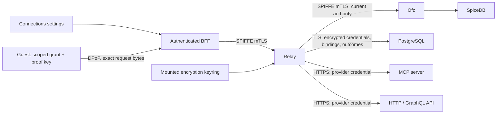

# Relay connector gateway

Relay is a Rust/Tokio service for reviewed MCP tools, HTTP API operations and GraphQL documents. Authentication is
independent of transport: public endpoints, bearer tokens, API keys, OAuth2 authorization code with PKCE, and OAuth2
client credentials. The [design](../../docs/tengri/relay-connectors.md) describes the trust boundaries.



The guest never receives provider access tokens, refresh tokens, application secrets or vault keys. Connections belong
to their creator; workspace bindings select named operations and optional JSON-pointer resource constraints. Ofz owns
membership, ownership and revocable grants. Read grants cannot invoke mutations. Saving agent access installs a local
MCP client through the existing controller and guest supervisor. API scripts can use the same client directly:

```sh
tengri-relay /home/agent/.tengri/relay/<connection-uuid>.json call list_issues '{"owner":"example","repo":"project"}'
```

The actual path follows the guest home configured by Nanoagent. The private configuration contains only a proof-bound
grant, connection ID, operation schemas and key-file path. Native policy currently limits these grants to one hour;
Settings displays the expiry and saving again renews access. This does not limit the lifetime of the connected account.
Ofz captures the running epoch when issuing a connector grant; a later restart requires saving agent access again.
Requests remain subject to the current runtime epoch, issuer permissions, membership, workspace binding and Ofz recovery
generation. Disconnect denies dispatch before erasing credentials and queues provider revocation when supported.
Guest cleanup is queued in the same database transaction before bindings are removed. Ready guests are reconciled
on disconnect, workspace listing and resume; sleeping guests retain their cleanup entry until removal is acknowledged.
A BFF restart or failed guest RPC does not lose the queue.
Automatic installation is staged in PostgreSQL before Ofz creates its grant. Relay denies that grant until the guest
acknowledges setup and the BFF activates it. Browser cancellation uses a separate bounded compensation signal. Failed
or abandoned installations remain denied and queue native grant revocation; workspace listing/resume retries it when
Ofz is available. No provider token or scoped grant secret is stored in this retry record.

## Configuration and storage

Required service inputs:

| Input                          | Purpose                                                         |
| ------------------------------ | --------------------------------------------------------------- |
| `RELAY_DATABASE_DSN`           | DNS-based PostgreSQL DSN, `sslmode=require`, no inline password |
| `RELAY_DATABASE_PASSWORD_FILE` | Mounted password for the selected database role                 |
| `RELAY_DATABASE_CA_FILE`       | Database CA bundle                                              |
| `RELAY_KEY_FILE`               | Mounted private JSON encryption keyring                         |
| `RELAY_CATALOG_FILE`           | Reviewed versioned provider definitions                         |
| `RELAY_OAUTH_CALLBACK`         | Registered HTTPS `/api/tengri/connectors/callback` URL          |
| `OFZ_GRPC_ENDPOINT`            | Ofz DNS authority and port                                      |
| `SPIFFE_ENDPOINT_SOCKET`       | Workload API Unix socket                                        |

The BFF needs `RELAY_ENDPOINT=https://relay.tengri.svc.cluster.local:8443`. Relay requires the exact existing broker
identity `spiffe://proompteng.ai/ns/tengri/sa/tengri-connector-broker`; only the Proompteng BFF identity may call its API.
No SpiceDB credential is mounted into Relay. The Ofz connector audience must match the guest's public endpoint
(`OFZ_CONNECTOR_AUDIENCE`, default `https://proompteng.ai/api/tengri/connectors/agent`).

Create a separate `relay_runtime` login before running `relay migrate` as the database/schema owner. Use the runtime
role for `relay serve` and `relay reencrypt`; it cannot change DDL or migration checksums. Credentials and PKCE verifiers
are AES-256-GCM envelopes in PostgreSQL. Associated data binds the connection, owner, provider and key ID. SQL backups
contain ciphertext. Keep vault keys in the secret manager separately from SQL backups, with restricted backup access.

The key file shape is `{"active":"v1","keys":{"v1":"<base64 of 32 random bytes>"}}`. Generate it through the approved
secret provisioning process; never commit it. For rotation, mount the old and new keys into every replica, select the
new active key, restart replicas, then run `relay reencrypt`. It rewrites connection credentials, pending authorization
attempts and provider-revocation records in locked batches. Retain old keys while replicas or restores can still need
them. A failed/incomplete rotation is an error and must be retried before retiring a key.

OAuth application secrets are backend files below `/var/run/secrets/relay/apps/`, distinct from the vault keyring.
`clientAuthentication` explicitly selects `none`, `clientSecretPost`, or `clientSecretBasic`. Client credentials require
application authentication. Authorization-code providers require S256 PKCE and bearer token responses. Provider scopes
use the OAuth space-separated representation. Unsupported legacy OAuth variants need a reviewed adapter.

Provider IDs and versions are immutable for connected accounts. Use a new ID for a changed destination or protocol;
keep the old definition available until its accounts have disconnected. A version mismatch denies invocation and revocation.

See [catalog.example.json](catalog.example.json) for a working HTTP catalog structure. Catalog paths may contain named
whole-segment parameters; remaining arguments become scalar query values for GET/DELETE or a JSON body for other
methods. GraphQL uses a fixed reviewed document and argument variables. MCP uses named tools and bounded JSON/SSE
responses. Provider definitions must classify mutations explicitly; POST alone does not determine read access.
All dispatches use HTTPS/443, pinned public IPv4 DNS answers, no redirects and no ambient proxy. IPv6-only/private
providers are unsupported. Arguments, responses and credentials are excluded from application logs and invocation rows.
Writes are never automatically retried. An unconfirmed write is recorded as `unknown`; check provider state before retrying.

## Validation and delivery

```sh
cargo fmt --check
cargo clippy --locked --all-targets -- -D warnings
cargo test --locked --all-targets
bash test-integration.sh
node --test ../nanoagent/relay-client.test.mjs
```

The integration script requires PostgreSQL binaries, OpenSSL, Python and `protoc`. It creates an isolated TLS database
and HTTPS OAuth/API/MCP provider; no account or production secret is used. Native Ofz integration separately checks
real SpiceDB decisions, proof replay, grants, runtime fencing and revocation. Browser coverage exercises Connections
Settings and accessibility using controlled BFF responses; it is not a production provider login.

The Relay image workflow validates and builds `relay-image` through the existing Nix OCI workflow. This change does not
provision a production database, keyring, provider applications or deployment. Before activation, enroll Relay through
the [Kargo release contract](../../docs/release-automation.md), including Warehouse, Stage, authorized ApplicationSet
target, SPIFFE registration, least-privilege network policies and secret-manager mounts. Permit only BFF ingress8443,
health probes8080, DNS, Ofz9443, the database and reviewed provider HTTPS egress. Set the BFF endpoint after readiness.

Roll out the coordinated Ofz/controller/guest/BFF cohort before enabling Relay. The additive native schema changes
(`create_connector`, connector owner/caller/manage/invoke) also require a reviewed SpiceDB schema installation against
the exact current schema. Preserve relationships and original bootstrap records; do not rerun platform bootstrap or
silently adopt an unknown schema hash. Fence policy changes during schema installation, verify the before/after schema
and role matrix, then resume. If activation fails, remove the BFF endpoint and stop Relay dispatch; preserve encrypted
records and old keys. Do not roll back to an image that lacks a required decryption key or erase authorization records.
Production acceptance must connect a real account, install selected operations, invoke from a running guest, refresh,
disconnect, and prove denial after revocation using the exact promoted images.
