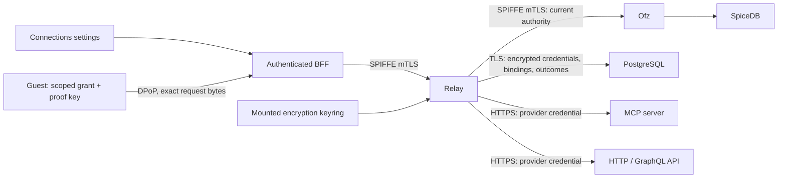

# Relay connector gateway

Relay is a Rust/Tokio service for reviewed MCP tools, HTTP API operations and GraphQL documents. Authentication is
independent of transport: public endpoints, bearer tokens, API keys, OAuth2 authorization code with PKCE, and OAuth2
client credentials. The [design](../../docs/tengri/relay-connectors.md) describes the trust boundaries.



Stage 2 extracts this private service from #15205. The Connections UI and BFF routes described below remain later-stage consumers; they are not included in this extraction. See the [private rollout runbook](../../argocd/applications/relay/README.md) for the prepared deployment and activation prerequisites.

The guest never receives provider access tokens, refresh tokens, application secrets or vault keys. Connections belong
to their creator; workspace bindings select named operations and optional JSON-pointer resource constraints. Ofz owns
membership, ownership and revocable grants. Read grants cannot invoke mutations. Saving agent access installs a local
MCP client through the existing controller and guest supervisor. API scripts can use the same client directly:

```sh
tengri-relay /home/agent/.tengri/relay/<connection-uuid>.json call list_issues '{"owner":"example","repo":"project"}'
```

The actual path follows the guest home configured by Nanoagent. The private configuration contains only a proof-bound
grant, connection ID, operation schemas and key-file path. Native policy currently limits these grants to one hour;
Settings displays the expiry and saving again renews access. This does not limit the lifetime of the connected account.
Ofz captures the running epoch when issuing a connector grant; a later restart requires saving agent access again.
Requests remain subject to the current runtime epoch, issuer permissions, membership, workspace binding and Ofz recovery
generation. Disconnect denies dispatch before erasing credentials and queues provider revocation when supported.
Guest cleanup is queued in the same database transaction before bindings are removed. Ready guests are reconciled
on disconnect, workspace listing and resume; sleeping guests retain their cleanup entry until removal is acknowledged.
A BFF restart or failed guest RPC does not lose the queue.
Automatic installation is staged in PostgreSQL before Ofz creates its grant. Relay denies that grant until the guest
acknowledges setup and the BFF activates it. Browser cancellation uses a separate bounded compensation signal. Failed
or abandoned installations remain denied and queue native grant revocation; workspace listing/resume retries it when
Ofz is available. No provider token or scoped grant secret is stored in this retry record.

## Configuration and storage

Required service inputs:

| Input                          | Purpose                                                         |
| ------------------------------ | --------------------------------------------------------------- |
| `RELAY_DATABASE_DSN`           | DNS-based PostgreSQL DSN, `sslmode=require`, no inline password |
| `RELAY_DATABASE_PASSWORD_FILE` | Mounted password for the selected database role                 |
| `RELAY_DATABASE_CA_FILE`       | Database CA bundle                                              |
| `RELAY_KEY_FILE`               | Mounted private JSON encryption keyring                         |
| `RELAY_CATALOG_FILE`           | Reviewed versioned provider definitions                         |
| `RELAY_OAUTH_CALLBACK`         | Registered HTTPS `/api/tengri/connectors/callback` URL          |
| `OFZ_GRPC_ENDPOINT`            | Ofz DNS authority and port                                      |
| `SPIFFE_ENDPOINT_SOCKET`       | Workload API Unix socket                                        |

The private API also requires the exact server-side opt-in `RELAY_DISPATCH_ENABLED=true`; all other values return
503 before command handling. Stage 2 explicitly sets this flag to false and ships an empty reviewed provider catalog.
Database readiness and maintenance remain available with dispatch disabled. The pool is bounded to four connections
per replica; the runtime role allows sixteen connections for two replicas and one rolling surge.

The later BFF needs `RELAY_ENDPOINT=https://relay.tengri.svc.cluster.local:8443`. Relay requires the exact existing broker
identity `spiffe://proompteng.ai/ns/tengri/sa/tengri-connector-broker`; only the Proompteng BFF identity may call its API.
No SpiceDB credential is mounted into Relay. The Ofz connector audience must match the guest's public endpoint
(`OFZ_CONNECTOR_AUDIENCE`, default `https://proompteng.ai/api/tengri/connectors/agent`).

Create a separate `relay_runtime` login before running `relay migrate` as the database/schema owner. Use the runtime
role for `relay serve` and `relay reencrypt`; it cannot change DDL or migration checksums. Credentials and PKCE verifiers
are AES-256-GCM envelopes in PostgreSQL. Associated data binds the connection, owner, provider and key ID. SQL backups
contain ciphertext. Keep vault keys in the secret manager separately from SQL backups, with restricted backup access.

The key file shape is `{"active":"v1","keys":{"v1":"<base64 of 32 random bytes>"}}`. Generate it through the approved
secret provisioning process; never commit it. For rotation, mount the old and new keys into every replica, select the
new active key, restart replicas, then run `relay reencrypt`. It rewrites connection credentials, pending authorization
attempts and provider-revocation records in locked batches. Retain old keys while replicas or restores can still need
them. A failed/incomplete rotation is an error and must be retried before retiring a key.

OAuth application secrets are backend files below `/var/run/secrets/relay/apps/`, distinct from the vault keyring.
`clientAuthentication` explicitly selects `none`, `clientSecretPost`, or `clientSecretBasic`. Client credentials require
application authentication. Authorization-code providers require S256 PKCE and bearer token responses. Provider scopes
use the OAuth space-separated representation. Unsupported legacy OAuth variants need a reviewed adapter.

Provider IDs and versions are immutable for connected accounts. Use a new ID for a changed destination or protocol.
A version mismatch denies invocation. Each issued OAuth credential includes an encrypted snapshot of its revocation
endpoint, client ID, authentication mode and application secret. Queued revocation uses that snapshot after catalog
version changes, catalog removal or deletion/rotation of the mounted application-secret file. Retain the provider-side
client registration and reviewed revocation network destinations until pending jobs and relevant backups are drained.

See [catalog.example.json](catalog.example.json) for a working HTTP catalog structure. Catalog paths may contain named
whole-segment parameters; remaining arguments become scalar query values for GET/DELETE or a JSON body for other
methods. GraphQL uses a fixed reviewed document and argument variables. MCP uses named tools and bounded JSON/SSE
responses. Provider definitions must classify mutations explicitly; POST alone does not determine read access.
All dispatches use HTTPS/443, pinned public IPv4 DNS answers, no redirects and no ambient proxy. IPv6-only/private
providers are unsupported. Arguments, responses and credentials are excluded from application logs and invocation rows.
Writes are never automatically retried. An unconfirmed write is recorded as `unknown`; check provider state before retrying.

## Validation and delivery

```sh
cargo fmt --check
cargo clippy --locked --all-targets -- -D warnings
cargo test --locked --all-targets
bash test-integration.sh
node --test ../nanoagent/relay-client.test.mjs
```

The integration script requires PostgreSQL binaries, OpenSSL, Python and `protoc`. It creates an isolated TLS database
and HTTPS OAuth/API/MCP provider; no account or production secret is used. Native Ofz integration separately checks
real SpiceDB decisions, proof replay, grants, runtime fencing and revocation. Browser coverage exercises Connections
Settings and accessibility using controlled BFF responses; it is not a production provider login.

The Relay image workflow validates the private gateway on PRs and publishes a main-only, receipt-bearing immutable
image through the existing Nix OCI workflow. The prepared GitOps application, database overlay, secret projections,
SPIFFE registration and held Kargo enrollment are in [the rollout runbook](../../argocd/applications/relay/README.md).
Source preparation does not establish production readiness or a provider login. Missing vault material must fail closed;
never create a replacement encryption key just to make a rollout healthy.

Stage 2 does not install the additive native SpiceDB schema or add BFF routes/UI. Before any canary, install that schema
through a reviewed migration against the exact current schema, preserving relationships and original bootstrap records.
Do not rerun platform bootstrap or adopt an unknown schema hash. Require the coordinated Ofz/controller/guest/BFF
cohort, server-enforced account/workspace eligibility, matching UI visibility, reviewed provider registration and an
explicit dispatch switch. Production acceptance must connect a real account, invoke selected operations from a running
guest, refresh, disconnect, and prove denial after revocation using the exact promoted images.
